## Operaciones Basicas con open cv
## Alumna Keyla Paola NC = 0033
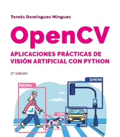

## 1. LECTURA DE LA IMAGEN DESDE LA CARPETA

## Cuando no puede cargar la imagen
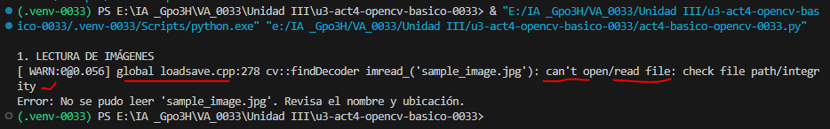
## Cuando puede leer la imagen 
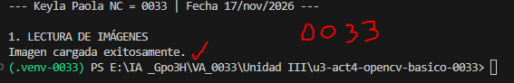

## 2. PROPIEDADES DE LA IMAGEN
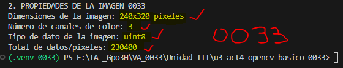

## 3. VISUALIZACIÓN DE LA IMAGEN ORIGINAL
## Mostrando imagen original
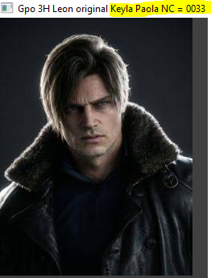

## 4. ACCESO Y MODIFICACIÓN DE PÍXELES INDIVIDUALES
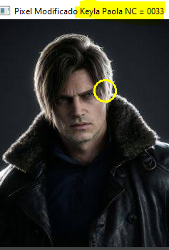
## Valor del pixel
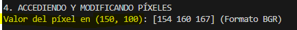

##  5. REGIÓN DE INTERÉS (ROI - REGION OF INTEREST)
## Con ROI marcada 
 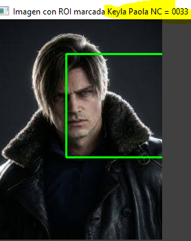
 ## ROI Extraido 
 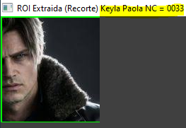

## 6. SEPARACIÓN Y FUSIÓN DE CANALES DE COLOR (BGR)
## Canal Azul (Escala de grises)
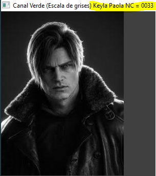
## Canal Azul (Coloreada)
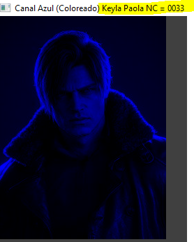
## Canal Verde (Escala de grises)
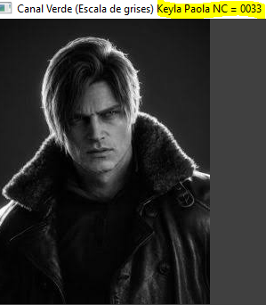
## Canal Verde (Coloreada)
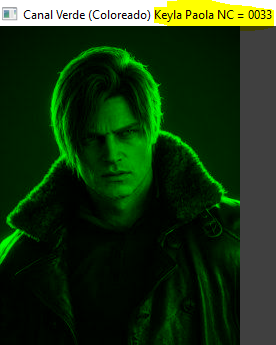
## Canal Rojo (Escala de grises)
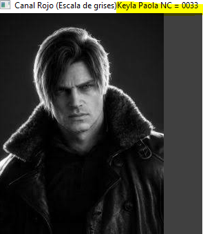
## Canal Rojo (Coloreada)
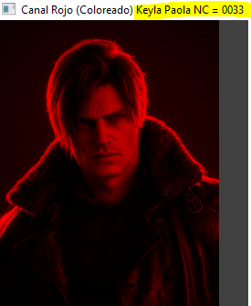

## 7. REDIMENSIONAMIENTO DE IMÁGENES (RESIZING)
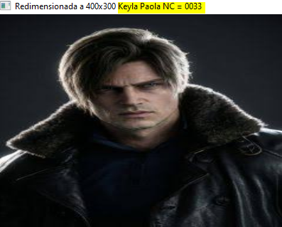
## Mitad de tamano (0.5x)
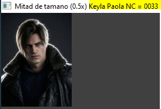
## Ampliada (1.5x)
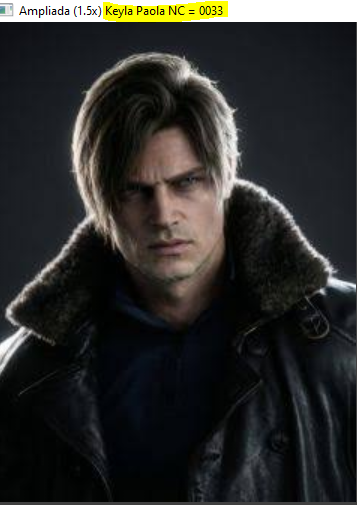
## 8. ROTACIÓN DE IMÁGENES
## Imagen Rotada (45 grados)
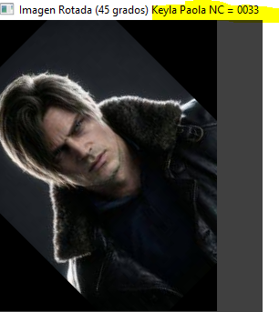
## 9. VOLTEO / ESPEJO DE IMÁGENES (FLIPPING)
## Volteo Horizontal (Espejo)
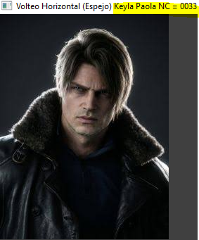
## Volteo Vertical (De cabeza)
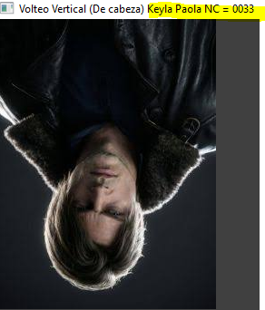
## Volteo en Ambos Ejes

##  10. GUARDADO DE RESULTADOS Y LIMPIEZA
## Imagen rotada guardada exitosamente como 'rotated_image.jpg'
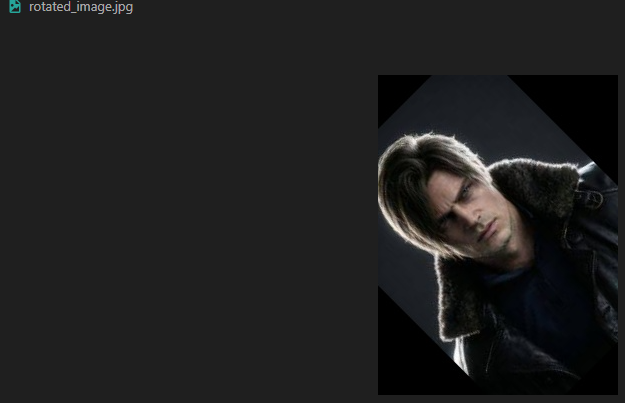